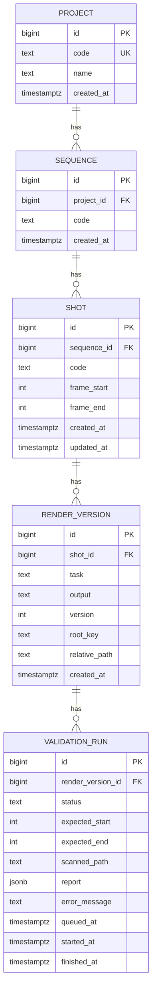

# VFX Shot Manager — System Specification (SPEC)

English | [繁體中文](SPEC.zh-TW.md)

> This document is the "big picture" of the project. Before writing code, decide what to build, what not to build, what the data looks like, how the layers talk to each other, and how things are named.
> If you find during development that the spec needs to change, **update this document first, then the code**, and record the decision in `docs/adr/`.

| Document | Purpose | When to read |
| --- | --- | --- |
| `docs/SPEC.md` (this file; Chinese: `SPEC.zh-TW.md`) | What the system should become | Before starting a new feature |
| `docs/ROADMAP.md` (bilingual) | Build order, checklist for each step, what you will learn | Every session — find the next unchecked item |
| `docs/DEVLOG.md` (bilingual) | Dev log: where you stopped, what blocked you, where to start next | First thing when starting, last thing when stopping |
| `CONTRIBUTING.md` (Chinese: `CONTRIBUTING.zh-TW.md`) | Code style, Git branch and commit conventions, definition of done | While coding and committing |
| `docs/adr/` | Architecture Decision Records (why A instead of B) | When making an important technical choice |

---

## 1. Goals and Scope

### 1.1 One-line summary

Help a small VFX team automatically check rendered EXR sequences for missing frames, extra frames, and naming errors before delivery, and keep a record of every check.

### 1.2 The problem

On a VFX production, the render farm occasionally fails a few frames, writes to the wrong folder, or produces misnamed files. When these problems are only found in comp or at delivery, frames must be re-rendered and time is lost. Many small teams still check by opening folders and looking. This system turns "checking" into one button (or one command) and stores the result as a traceable report.

### 1.3 User roles

| Role | Does what |
| --- | --- |
| Coordinator | Creates projects, sequences, and shots; sets delivery frame ranges; queues checks; reads reports |
| Artist | Registers render versions (which shot, task, output, and folder) |
| Pipeline TD | Maintains naming conventions, configures render roots, runs checks from the CLI or Nuke |

v1 has no login; everyone shares one identity (see §14 Security).

**Where it sits in the pipeline**

The system checks **rendered image sequences**, whichever department produced them. Its main use is as a quality gate at the lighting → comp handoff, where 3D scene data has become 2D images.

```text
Layout / Animation ──▶ FX ──▶ Lighting ──[ check ]──▶ Comp ──[ check ]──▶ Delivery
                        └──── FX renders ──[ check ]──┘
```

| Department | When they use it | Question it answers |
| --- | --- | --- |
| Lighting (producer) | After rendering, before handing off to comp | "Is my render complete and ready to hand off?" |
| FX (producer) | After rendering FX elements | "Is every FX layer complete?" |
| Comp (consumer) | Before starting a comp | "Is the version I'm about to use complete?" |
| Comp (producer) | Before client delivery | "Does the final output match the cut's frame range?" |
| Production | Tracking progress, preparing delivery | "Which shots have passed?" |

Not covered: 3D scene data passed between 3D departments (USD, Alembic caches, VDB). Checking those means reading file contents, not just names and frame numbers (see §1.5).

### 1.4 Success criteria (v1 is done when all of these hold)

1. After `git clone` on a clean machine, one command from the README starts the whole system.
2. In the browser: create a shot → register a version → queue a check → see missing `1003, 1006`.
3. After adding the missing files and checking again → status becomes `passed`, and the earlier `failed` report is still available.
4. The same check runs from the CLI in a terminal, and all tests pass in CI.

### 1.5 Out of scope (deliberately not in v1)

- User login and permissions
- Checking 3D scene data passed between 3D departments (USD, Alembic, VDB)
- Reading EXR contents (headers, compression, corrupt files, black frames, image quality) — only **filenames** and **frame numbers** are checked
- Recursive scanning of subfolders
- Integration with production tracking (ShotGrid / Flow / ftrack)
- Cloud deployment (local Docker only)

These are listed in §17 Future work. **Writing down what is out of scope is the key to a project that actually finishes.**

---

## 2. Glossary

| Term | Meaning | Example in this system |
| --- | --- | --- |
| Project | A film or job | `DEMO` |
| Sequence | A scene containing several shots | `SEQ010` |
| Shot | One shot | `SH010` |
| Frame range | Frames required for delivery, **inclusive at both ends** | `1001–1006` |
| Handles | Extra frames rendered before and after the cut (v1 includes them in the frame range rather than storing them separately) | — |
| Task | Department / step | `lighting`, `comp`, `fx` |
| Output | Output item; in lighting usually called an AOV / render pass | `beauty`, `diffuse`, `specular` |
| Version | Which iteration of an output | `v001` |
| Render root | A render directory the studio allows the system to read, referred to by a key | key=`demo` → `/renders/demo` |
| Render version | A registration of "version N of this shot/task/output lives here" | `SH010 / lighting / beauty / v001` |
| Validation run | One execution of a check on a render version | run #12 |
| Report | The result of one run | missing `1003, 1006` |
| Finding | One problem inside a report | `missing_frame`, `bad_filename` |
| DCC | Content creation software (Digital Content Creation) | Nuke, Maya, Houdini |

---

## 3. User Stories and Acceptance Criteria

Each story has an ID that the roadmap and commits refer to.

| ID | As a… | I want to… | Acceptance criteria |
| --- | --- | --- | --- |
| US-01 | Pipeline TD | Check a folder from the terminal | `vfxsm scan` prints the result; exit code 0 for passed, 1 for failed, 2 for error |
| US-02 | Pipeline TD | Save the result as JSON | `--json report.json` writes a file in the §7.4 format |
| US-03 | Coordinator | Create projects, sequences, and shots | Duplicate codes return 409; start frame > end frame returns 422 |
| US-04 | Coordinator | Set a shot's delivery range | Changing the range does not alter past reports (reports store a snapshot) |
| US-05 | Artist | Register a render version | Same shot/task/output/version cannot be registered twice; a path escaping the root returns 422 |
| US-06 | Coordinator | Queue a check | Returns 202 and a run ID immediately, without waiting for the scan |
| US-07 | Coordinator | See check status and results | Status moves `queued` → `running` → `passed/failed/error`; the page shows missing frames |
| US-08 | Coordinator | Recheck after a re-render and see history | One version can have many runs, listed by time |
| US-09 | Coordinator | Download a report | Downloaded JSON matches the API response |
| US-10 | New developer | Run the system from scratch | README steps reproduce in a clean environment, including sample data |
| US-11 (bonus) | Compositor | Select a Write node in Nuke and check its output | A Nuke panel shows missing frames |

---

## 4. Requirements

### 4.1 Functional requirements

As defined by the user stories in §3.

### 4.2 Non-functional requirements

| Category | Requirement |
| --- | --- |
| Performance | Core validation of a 10,000-frame folder completes within 2 seconds (compare with a `set`, not a `list`) |
| Reliability | If a worker dies mid-job, runs stuck in `running` too long are re-queued |
| Security | The worker has **read-only** access to render roots; the API does not accept absolute paths |
| Portability | Core runs on Windows and Linux (use `pathlib` everywhere) |
| Compatibility | The `core` package uses only the Python standard library and is compatible with Python 3.11, so it can be imported directly inside DCC applications such as Nuke |
| Testability | `core` coverage ≥ 90%, overall ≥ 80% |
| Reproducibility | One `compose.yaml` plus one sample-data script is enough to demo |

---

## 5. Pipeline Naming Conventions

### 5.1 Directories and filenames

```text
<render_root>/<project>/<sequence>/<shot>/<task>/<output>/v<version>/
    <shot>_<task>_<output>.<frame>.exr
```

Example:

```text
/renders/demo/DEMO/SEQ010/SH010/lighting/beauty/v001/
    SH010_lighting_beauty.1001.exr
    SH010_lighting_beauty.1002.exr
    SH010_lighting_beauty.1004.exr
    SH010_lighting_beauty.1005.exr
```

### 5.2 Field rules

| Field | Rule | Regex |
| --- | --- | --- |
| project | Uppercase alphanumeric, 2–10 characters | `[A-Z][A-Z0-9]{1,9}` |
| sequence | `SEQ` + 3 digits | `SEQ\d{3}` |
| shot | `SH` + 3 digits | `SH\d{3}` |
| task | Lowercase letters | `[a-z]+` |
| output | Lowercase alphanumeric | `[a-z][a-z0-9]*` |
| version | `v` + 3 digits, starting at `v001` | `v\d{3}` |
| frame | 4 digits, zero-padded | `\d{4}` |
| extension | Lowercase `.exr` | `exr` |

The full filename regex (in `core/naming.py`, the single source of truth for the convention):

```python
FILENAME_PATTERN = re.compile(
    r"^(?P<shot>SH\d{3})_(?P<task>[a-z]+)_(?P<output>[a-z][a-z0-9]*)"
    r"\.(?P<frame>\d{4})\.exr$"
)
```

### 5.3 Validation rules

One check covers **one** version folder and does **not recurse**. Every entry in the folder is classified as:

| Finding type | How it is detected |
| --- | --- |
| `missing_frame` | A frame inside the range that should exist but is not found |
| `out_of_range_frame` | Valid filename, but the frame is outside the range |
| `bad_filename` | Does not match the regex (including wrong padding or uppercase extension) |
| `mismatched_name` | Matches the regex, but shot / task / output differ from the registration (e.g. an SH020 file in the SH010 folder) |
| `unexpected_entry` | A subfolder or any other non-file entry |

### 5.4 Status

| Status | Condition |
| --- | --- |
| `passed` | No findings |
| `failed` | At least one finding (an **empty folder** is also failed, because every frame is missing) |
| `error` | The folder does not exist, cannot be read, or the path is invalid — the check could not run |

### 5.5 Version rules

- A re-render for delivery → create a **new version** (v002); never overwrite v001.
- A few frames added to the same version and checked again → a **new run** on the same version; old reports are kept.

### 5.6 Displaying frame lists

Reports and the UI show consecutive frames in compact form, a common industry notation:

```text
[1001, 1002, 1003, 1005, 1007, 1008] → "1001-1003,1005,1007-1008"
```

---

## 6. System Architecture

### 6.1 Overview

```text
┌──────────────┐   HTTP/JSON   ┌──────────────┐  SQLAlchemy  ┌──────────────┐
│   Browser    │ ────────────▶ │   FastAPI    │ ───────────▶ │  PostgreSQL  │
│ React + TS   │ ◀──────────── │   (api)      │ ◀─────────── │              │
└──────────────┘               └──────────────┘              └──────▲───────┘
                                                                     │ claim job / write result
┌──────────────┐               ┌──────────────┐                     │
│  Terminal    │               │   Worker     │ ────────────────────┘
│  vfxsm CLI   │               │  (python)    │
└──────┬───────┘               └──────┬───────┘
       │                              │
       ▼                              ▼
┌─────────────────────────────────────────────┐        ┌──────────────────────────┐
│     core (pure Python, standard library)    │ ─────▶ │ Render storage (read-only)│
│  naming · frame_range · scanner · validator │        └──────────────────────────┘
└─────────────────────────────────────────────┘
       ▲
       │ (bonus)
┌──────┴───────┐
│ Nuke panel   │
└──────────────┘
```

### 6.2 The most important design rule: core knows nothing about the outside world

- `core` never imports FastAPI, SQLAlchemy, React, or Nuke.
- Inside `core` there are two kinds of code:
  - **Pure functions** (`naming`, `frame_range`, `validator`): data in, data out, no filesystem access → easiest to test.
  - **I/O functions** (`scanner`): the only place that reads folders.
- So the same validation logic is shared by the CLI, the worker, and Nuke, and tests do not need real EXR files.

### 6.3 Component responsibilities

| Component | Responsible for | Not responsible for |
| --- | --- | --- |
| `core` | Name parsing, range math, scanning, building reports | Database, HTTP |
| `cli` | Parsing arguments, calling core, printing text or JSON, choosing the exit code | Business logic |
| `api` | Validating requests, CRUD, creating runs (status=queued) | Scanning files (too slow; would block requests) |
| `db` | ORM models, sessions, migrations | Business logic |
| `worker` | Claiming queued runs, resolving paths, calling core, writing results | HTTP |
| `frontend` | Screens, forms, polling run status | Any validation logic |

### 6.4 Flow of one check

```text
User clicks "Validate"
  → POST /api/v1/versions/42/validation-runs
  → API inserts validation_run(status=queued, snapshot of frame range and path) → returns 202 + run_id
  → Frontend GETs /api/v1/validation-runs/{run_id} every 2 seconds
Worker loop:
  → Claims one queued run with SELECT … FOR UPDATE SKIP LOCKED → sets it to running
  → Resolves root_key + relative_path to a real path and confirms it stays inside the root
  → core.scan() → core.validate() → Report
  → Writes status, report, finished_at in one transaction
Frontend sees status become passed / failed / error → shows the report
```

### 6.5 Final folder structure

```text
vfx-shot-manager/
├── .github/
│   ├── workflows/ci.yml          # GitHub Actions
│   └── pull_request_template.md
├── docs/
│   ├── SPEC.md / SPEC.zh-TW.md   # this document (EN / ZH)
│   ├── ROADMAP.md                # bilingual
│   ├── DEVLOG.md                 # bilingual
│   └── adr/                      # architecture decision records
├── src/vfx_shot_manager/
│   ├── __init__.py
│   ├── core/                     # pure Python, standard library only
│   │   ├── naming.py             # naming regex, filename parsing
│   │   ├── frame_range.py        # range parsing, compact display "1001-1003,1005"
│   │   ├── scanner.py            # the only module that reads the filesystem
│   │   ├── validator.py          # comparison, builds the Report
│   │   ├── report.py             # Report dataclass, JSON conversion
│   │   ├── paths.py              # root resolution, path-traversal guard
│   │   └── errors.py             # custom exceptions
│   ├── cli.py                    # vfxsm command
│   ├── config.py                 # reads environment variables
│   ├── db/
│   │   ├── models.py             # SQLAlchemy models
│   │   └── session.py
│   ├── api/
│   │   ├── main.py               # FastAPI app
│   │   ├── schemas.py            # Pydantic request/response models
│   │   └── routes/               # projects.py, shots.py, versions.py, runs.py
│   └── worker.py
├── migrations/                   # Alembic
├── frontend/                     # React + TypeScript
├── nuke/                         # (bonus) Nuke panel
├── tests/
│   ├── core/
│   ├── api/
│   └── worker/
├── sample_renders/               # generated by make-sample, not committed
├── compose.yaml
├── pyproject.toml
├── .env.example
├── .gitignore
├── CONTRIBUTING.md / CONTRIBUTING.zh-TW.md
├── README.md
└── README.zh-TW.md
```

The `src/` layout prevents accidentally importing code that has not been installed when you run from the project root. It is the layout the Python community recommends.

---

## 7. Database Design

### 7.1 ER diagram



(GitHub renders mermaid diagrams automatically.)

### 7.2 Tables and constraints

| Table | Constraints |
| --- | --- |
| `projects` | `code` UNIQUE |
| `sequences` | UNIQUE(`project_id`, `code`); FK → projects ON DELETE RESTRICT |
| `shots` | UNIQUE(`sequence_id`, `code`); CHECK(`frame_start` <= `frame_end`); CHECK(`frame_start` >= 0) |
| `render_versions` | UNIQUE(`shot_id`, `task`, `output`, `version`); CHECK(`version` > 0) |
| `validation_runs` | CHECK(`status` IN ('queued','running','passed','failed','error')); INDEX(`status`, `queued_at`) so the worker can find jobs |

Naming: lowercase plural table names, snake_case columns, primary key always `id bigint generated always as identity`, timestamps always `timestamptz` (stored in UTC).

### 7.3 Why runs store a "snapshot"

A shot's range may change later (1001–1006 becomes 1001–1010). If a report only stored shot_id, the "missing frames" in old reports would be misread. So when a run is created, `expected_start`, `expected_end`, and `scanned_path` are copied into the run.

### 7.4 Report JSON format (used by the `report` column, CLI output, and downloads)

```json
{
  "schema_version": 1,
  "status": "failed",
  "shot": "SH010",
  "task": "lighting",
  "output": "beauty",
  "version": 1,
  "expected_range": { "start": 1001, "end": 1006 },
  "scanned_path": "DEMO/SEQ010/SH010/lighting/beauty/v001",
  "summary": {
    "expected_count": 6,
    "found_count": 4,
    "missing_count": 2
  },
  "missing_frames": [1003, 1006],
  "missing_frames_compact": "1003,1006",
  "out_of_range_frames": [],
  "bad_filenames": [],
  "mismatched_names": [],
  "unexpected_entries": [],
  "scanned_at": "2026-11-18T08:30:00Z"
}
```

`schema_version` lets old reports remain readable after the format changes.

---

## 8. API Specification

### 8.1 Common rules

- Prefix `/api/v1`
- JSON fields in `snake_case`
- Timestamps in ISO 8601, UTC (`2026-11-18T08:30:00Z`)
- Lists support `?limit=50&offset=0` and return `{ "items": [...], "total": 123 }`
- One error format everywhere:

```json
{ "error": { "code": "duplicate_shot", "message": "Shot SH010 already exists in SEQ010", "details": {} } }
```

| HTTP status | When |
| --- | --- |
| 200 | Read succeeded |
| 201 | Created |
| 202 | Queued (validation run) |
| 404 | Unknown ID |
| 409 | Duplicate (UNIQUE violation) |
| 422 | Invalid data or rule violation (FastAPI validation errors are also 422) |

### 8.2 Endpoints

| Method | Path | Purpose | Story |
| --- | --- | --- | --- |
| GET | `/health` | Health check (including database connection) | — |
| GET | `/api/v1/projects` | List projects | US-03 |
| POST | `/api/v1/projects` | Create a project | US-03 |
| GET | `/api/v1/projects/{id}/sequences` | List sequences | US-03 |
| POST | `/api/v1/projects/{id}/sequences` | Create a sequence | US-03 |
| GET | `/api/v1/sequences/{id}/shots` | List shots | US-03 |
| POST | `/api/v1/sequences/{id}/shots` | Create a shot | US-03 |
| GET | `/api/v1/shots/{id}` | Shot details (versions and latest run status) | US-07 |
| PATCH | `/api/v1/shots/{id}` | Change the delivery range | US-04 |
| POST | `/api/v1/shots/{id}/versions` | Register a render version | US-05 |
| GET | `/api/v1/versions/{id}/validation-runs` | Check history for a version | US-08 |
| POST | `/api/v1/versions/{id}/validation-runs` | Queue a check → 202 | US-06 |
| GET | `/api/v1/validation-runs/{id}` | Read status and report | US-07 |
| GET | `/api/v1/validation-runs/{id}/report.json` | Download the report (`Content-Disposition: attachment`) | US-09 |
| GET | `/api/v1/render-roots` | Available root keys (for the frontend dropdown) | US-05 |

### 8.3 Examples

Create a shot:

```http
POST /api/v1/sequences/3/shots
{ "code": "SH010", "frame_start": 1001, "frame_end": 1006 }

201 Created
{ "id": 7, "sequence_id": 3, "code": "SH010", "frame_start": 1001, "frame_end": 1006,
  "created_at": "2026-11-18T08:00:00Z", "updated_at": "2026-11-18T08:00:00Z" }
```

Register a version:

```http
POST /api/v1/shots/7/versions
{ "task": "lighting", "output": "beauty", "version": 1,
  "root_key": "demo", "relative_path": "DEMO/SEQ010/SH010/lighting/beauty/v001" }
```

Queue a check:

```http
POST /api/v1/versions/42/validation-runs

202 Accepted
{ "id": 12, "status": "queued", "queued_at": "2026-11-18T08:30:00Z" }
```

Once the API is running, FastAPI generates interactive docs at `http://localhost:8000/docs`.

---

## 9. Worker Specification

| Item | Spec |
| --- | --- |
| How it runs | Separate process: `python -m vfx_shot_manager.worker` |
| Polling | When idle, checks every 2 seconds (`WORKER_POLL_SECONDS`) |
| Claiming | `SELECT … WHERE status='queued' ORDER BY queued_at LIMIT 1 FOR UPDATE SKIP LOCKED`, then sets `running` and `started_at` in the same transaction. Several workers never claim the same run |
| Writing results | status, report, error_message, finished_at written in **one transaction** |
| Stale recovery | Runs in `running` longer than `WORKER_STALE_MINUTES` (default 10) are reset to `queued` at startup and periodically |
| Exceptions | Folder unreadable → `error` with a message; a bug in the code → log it, set the run to `error`, keep the worker alive |
| Shutdown | On Ctrl+C / SIGTERM, finish the current run, then exit |

Why not Celery or Redis: v1 traffic is tiny, so using PostgreSQL as the queue removes one service, and `SKIP LOCKED` already provides safe concurrent claiming. See `docs/adr/0001-tech-stack.md`.

---

## 10. CLI Specification

```text
vfxsm scan <directory> --shot SH010 --task lighting --output beauty --range 1001-1006 [--json report.json]
vfxsm make-sample <directory> --shot SH010 --task lighting --output beauty --range 1001-1006 --skip 1003,1006
```

| Command | Purpose |
| --- | --- |
| `scan` | Check one folder and print a human-readable summary; `--json` also writes a report file |
| `make-sample` | Generate a fake EXR sequence (empty files) for tests and demos, optionally skipping chosen frames |

Exit codes: `0` passed, `1` failed, `2` error. This is what lets other scripts and CI chain the tool.

Example output:

```text
SH010 lighting/beauty v001  FAILED
Expected 1001-1006 (6 frames), found 4
Missing: 1003,1006
```

---

## 11. Frontend Specification

### 11.1 Technology

React + TypeScript (built with Vite), React Router, TanStack Query (API requests, caching, polling). Plain CSS at first; design polish is not a goal.

### 11.2 Pages

| Route | Page | Content |
| --- | --- | --- |
| `/` | Project list | Project cards, create-project form |
| `/projects/:id` | Project page | Sequences and shots as a tree; create sequence / shot |
| `/shots/:id` | Shot page (main screen) | Shot info and range; versions table (each row: task / output / version / latest status / Validate button); register-version form |
| `/runs/:id` | Report page | Status badge, summary, missing frames, each finding type, JSON download |

### 11.3 States every screen must handle

Loading, empty, error (show the API's `error.message`), success.

### 11.4 Status colours

`queued` grey, `running` blue, `passed` green, `failed` orange, `error` red.

---

## 12. Configuration and Environment Variables

All settings come from environment variables (`pydantic-settings`). Locally they live in `.env`, which is not committed; only `.env.example` is.

| Variable | Example | Description |
| --- | --- | --- |
| `DATABASE_URL` | `postgresql+psycopg://vfx:vfx@db:5432/vfx` | Database connection |
| `RENDER_ROOTS` | `demo=/renders/demo` | Allowed roots, comma-separated |
| `WORKER_POLL_SECONDS` | `2` | Worker polling interval |
| `WORKER_STALE_MINUTES` | `10` | When a running job counts as stuck |
| `LOG_LEVEL` | `INFO` | Log level |
| `CORS_ORIGINS` | `http://localhost:5173` | Allowed frontend origins |
| `VITE_API_BASE_URL` | `http://localhost:8000` | API address used by the frontend |

---

## 13. Error Handling and Logging

- `core` defines its own exceptions: `VfxShotManagerError` → `InvalidFrameRangeError`, `DirectoryUnreadableError`, `PathOutsideRootError`.
- Library code **never uses `print`**; it uses `logging.getLogger(__name__)`. Only the CLI prints for humans.
- The API converts exceptions to the §8.1 error format with exception handlers and never returns Python tracebacks to the frontend.
- Every worker log line for a run includes `run_id` for tracing.

---

## 14. Security

| Risk | Mitigation |
| --- | --- |
| Path traversal (`../../etc`) | The API only accepts relative paths; the worker calls `Path.resolve()` and checks `is_relative_to(root)`, rejecting anything outside |
| Accidentally deleting or modifying renders | Render directories are mounted `:ro` (read-only) in Docker; the code never writes to render directories |
| Leaked credentials | `.env` is in `.gitignore`; the README only shows example values |
| Unauthorized use | v1 is local-only, with no login; the README states clearly that shared deployment requires authentication first |
| SQL injection | Always use SQLAlchemy parameterized queries; never build SQL strings by hand |

---

## 15. Testing Strategy

| Level | What is tested | Tools | Needs a database? |
| --- | --- | --- | --- |
| Unit | All cases of `naming`, `frame_range`, `validator` | pytest | No |
| Filesystem | `scanner`: complete sequence, missing frames, empty folder, missing folder, subfolders, bad filenames | pytest + `tmp_path` | No |
| CLI | Exit codes, JSON output | pytest + `capsys` / `subprocess` | No |
| API | Success, 404, 409, 422 for every endpoint | pytest + FastAPI `TestClient` | Yes (test PostgreSQL) |
| Worker integration | Claiming, writing results, stale recovery | pytest + test database + `tmp_path` | Yes |
| Frontend | Main components and forms | Vitest + Testing Library (optional) | No |
| End-to-end | Walk through the whole flow manually, record a GIF for the README | Manual | Yes |

Required core test cases: complete sequence, missing middle frame, missing first frame, missing last frame, all missing (empty folder), out-of-range frame, wrong padding (`.101.exr`), uppercase extension, another shot's file, subfolder, missing folder, start greater than end, single-frame range.

---

## 16. Development Environment, Deployment, and CI

### 16.1 Tool versions

| Tool | Version |
| --- | --- |
| Python | 3.12 (core compatible with 3.11) |
| Package management | `uv` (virtual environments, dependencies, running commands) |
| Lint / format | `ruff` |
| Type checking | `mypy` (core only, to start) |
| Testing | `pytest`, `pytest-cov` |
| Database | PostgreSQL 16 |
| ORM / migrations | SQLAlchemy 2.x, Alembic |
| Backend | FastAPI, Uvicorn, pydantic-settings |
| Frontend | Node 22 LTS, Vite, React, TypeScript |
| Containers | Docker Desktop, Docker Compose |
| CI | GitHub Actions |

### 16.2 Docker Compose services

| Service | Port | Description |
| --- | --- | --- |
| `db` | 5432 | PostgreSQL, data in a named volume |
| `api` | 8000 | FastAPI |
| `worker` | — | Mounts `./sample_renders:/renders/demo:ro` |
| `frontend` | 5173 | Vite dev server |

### 16.3 CI (runs on every push and PR)

1. `ruff check` and `ruff format --check`
2. `mypy src/vfx_shot_manager/core`
3. `pytest --cov` (with a PostgreSQL service container)
4. Frontend `npm run build` (from M4)

The README shows a CI badge so anyone can see at a glance whether tests pass.

---

## 17. Future Work (after v1)

| Item | Value |
| --- | --- |
| Nuke panel (ROADMAP M6) | Artists run checks inside the DCC they already use |
| Read EXR headers with OpenEXR to check resolution, channels, corrupt files | Upgrades from filename checks to content checks |
| ShotGrid / Flow Production Tracking integration | Sync shots and ranges from production tracking |
| User login and role-based permissions | Required for shared deployment |
| Multiple filename patterns (`%04d`, `####`) and recursive scanning | Adapts to other studios' conventions |
| Slack / email notifications | Automatic alerts when a check fails |
