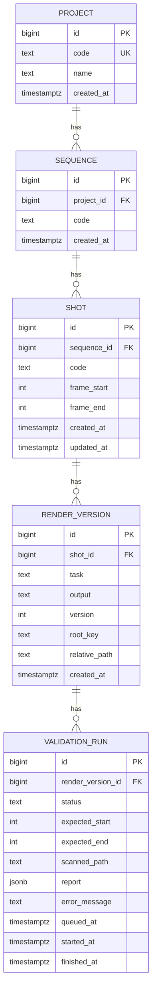

# VFX Shot Manager — 系統規格書（SPEC）

[English](SPEC.md) | 繁體中文

> 這份文件是整個專案的「大框架」。寫程式之前先決定好：做什麼、不做什麼、資料長什麼樣、各層怎麼溝通、命名怎麼取。
> 寫程式的過程中如果發現規格需要改，**先改這份文件，再改程式**，並在 `docs/adr/` 留下決策紀錄。

| 文件 | 用途 | 什麼時候看 |
| --- | --- | --- |
| `docs/SPEC.zh-TW.md`（本文件，英文版 `SPEC.md`） | 系統要做成什麼樣子 | 開始一個新功能前 |
| `docs/ROADMAP.md`（中英對照） | 做的順序、每一步的勾選清單、會學到什麼 | 每次開工，找下一個沒打勾的項目 |
| `docs/DEVLOG.md`（中英對照） | 開發日誌：上次做到哪、卡在哪、下次從哪開始 | 每次開工第一個看、收工最後一個寫 |
| `CONTRIBUTING.zh-TW.md`（英文版 `CONTRIBUTING.md`） | 程式風格、Git 分支與 commit 規範、完成定義 | 寫 code 和 commit 時 |
| `docs/adr/` | 架構決策紀錄（為什麼選 A 不選 B） | 做了重要技術選擇時 |

---

## 1. 專案目標與範圍

### 1.1 一句話說明

讓小型 VFX 團隊在交付前，自動檢查渲染出來的 EXR 序列有沒有缺幀、多幀、檔名錯誤，並保留每一次檢查的紀錄。

### 1.2 要解決的問題

在 VFX 製作現場，算圖農場（render farm）偶爾會有幾格失敗、輸出到錯的資料夾、或檔名打錯。這些問題如果到合成或交付時才發現，就要回頭補算，浪費時間。目前很多小團隊靠人工打開資料夾肉眼檢查。這個系統把「檢查」變成一個按鈕（或一行指令），並把結果存成可以追溯的報告。

### 1.3 使用者角色

| 角色 | 做什麼 |
| --- | --- |
| Coordinator（製片協調） | 建立專案、場次、鏡頭，設定交付影格範圍，送出檢查，看報告 |
| Artist（藝術家） | 登記渲染版本（哪個鏡頭、哪個工序、哪個輸出、放在哪個資料夾） |
| Pipeline TD | 維護命名規範、設定渲染根目錄、用 CLI 或 Nuke 直接檢查 |

v1 不做登入，所有人都是同一個身分（見 §14 安全）。

### 1.4 成功標準（做到這些就算 v1 完成）

1. 從乾淨的電腦 `git clone` 下來，照 README 執行一行指令就能把整套系統跑起來。
2. 在網頁上建立鏡頭 → 登記版本 → 送出檢查 → 看到缺少 `1003, 1006`。
3. 補上缺的檔案後再檢查一次 → 狀態變成 `passed`，而且前一次 `failed` 的報告還查得到。
4. 同一個檢查功能也可以用 CLI 在終端機執行，CI 上所有測試通過。

### 1.5 範圍外（v1 刻意不做）

- 使用者登入、權限
- 解析 EXR 內容（header、壓縮、壞檔、黑格、畫面品質）——只檢查「檔名」和「影格編號」
- 遞迴掃描子資料夾
- 串接 ShotGrid / Flow / ftrack 等製作管理系統
- 雲端部署（只做本機 Docker）

這些都寫在 §17 未來擴充。**範圍外的東西寫清楚，是避免專案永遠做不完的關鍵。**

---

## 2. 名詞表（Glossary）

| 名詞 | 意思 | 在本系統的例子 |
| --- | --- | --- |
| Project | 一部片或一個案子 | `DEMO` |
| Sequence | 一場戲，包含多個鏡頭 | `SEQ010` |
| Shot | 一個鏡頭 | `SH010` |
| Frame range | 交付需要的影格範圍，**包含頭尾** | `1001–1006` |
| Handles | 剪接點前後多算的保留格數（v1 直接包含在 frame range 內，不另外存） | — |
| Task | 工序／部門 | `lighting`、`comp`、`fx` |
| Output | 輸出項目，lighting 常稱 AOV / render pass | `beauty`、`diffuse`、`specular` |
| Version | 同一個 output 的第幾版 | `v001` |
| Render root | 公司允許系統讀取的渲染根目錄，用一個 key 代表 | key=`demo` → `/renders/demo` |
| Render version | 「某鏡頭某工序某輸出的第幾版放在哪裡」這筆登記 | `SH010 / lighting / beauty / v001` |
| Validation run | 對某個 render version 執行一次檢查 | run #12 |
| Report | 一次檢查的結果 | 缺 `1003, 1006` |
| Finding | 報告裡的一個問題 | `missing_frame`、`bad_filename` |
| DCC | 製作軟體（Digital Content Creation） | Nuke、Maya、Houdini |

---

## 3. 使用者故事與驗收條件

每個故事有編號，ROADMAP 和 commit 會引用這些編號。

| ID | 身為… | 我想要… | 驗收條件 |
| --- | --- | --- | --- |
| US-01 | Pipeline TD | 在終端機對一個資料夾執行檢查 | `vfxsm scan` 印出結果；passed 回傳 exit code 0、failed 回傳 1、error 回傳 2 |
| US-02 | Pipeline TD | 把檢查結果存成 JSON | `--json report.json` 產生符合 §7.4 格式的檔案 |
| US-03 | Coordinator | 建立專案、場次、鏡頭 | 重複代號回 409；起始格 > 結束格回 422 |
| US-04 | Coordinator | 設定鏡頭的交付範圍 | 修改範圍不影響過去報告（報告存的是當時的快照） |
| US-05 | Artist | 登記渲染版本 | 同鏡頭同工序同輸出同版號不能重複；路徑跳出根目錄回 422 |
| US-06 | Coordinator | 送出檢查 | 立刻回 202 和 run ID，不用等掃描完 |
| US-07 | Coordinator | 看檢查狀態與結果 | 狀態從 `queued` → `running` → `passed/failed/error`；頁面看得到缺少的影格 |
| US-08 | Coordinator | 補算後重新檢查並看歷史 | 同一個版本可以有多次 run，依時間排序列出 |
| US-09 | Coordinator | 下載報告 | 下載的 JSON 和 API 回傳內容一致 |
| US-10 | 新加入的開發者 | 從零開始把系統跑起來 | README 的步驟在乾淨環境可重現，含範例資料 |
| US-11（加分） | Compositor | 在 Nuke 裡選 Write node 直接檢查輸出 | Nuke 面板顯示缺少的影格 |

---

## 4. 需求

### 4.1 功能需求

依照 §3 使用者故事。

### 4.2 非功能需求

| 類別 | 要求 |
| --- | --- |
| 效能 | 掃描一個 10,000 格的資料夾，核心檢查在 2 秒內完成（用 `set` 比對，不用 `list`） |
| 可靠性 | worker 中途當掉，`running` 太久的工作會被重新排回佇列 |
| 安全 | worker 只能**唯讀**存取渲染根目錄；API 不接受絕對路徑 |
| 可移植 | 核心程式在 Windows 和 Linux 都能跑（全面使用 `pathlib`） |
| 相容性 | `core` 套件只用 Python 標準函式庫，相容 Python 3.11，這樣才能直接放進 Nuke 等 DCC 內建的 Python 使用 |
| 可測試 | `core` 的覆蓋率 ≥ 90%，整體 ≥ 80% |
| 可重現 | 一份 `compose.yaml` + 一份範例資料產生腳本就能 demo |

---

## 5. Pipeline 命名規範

### 5.1 目錄與檔名

```text
<render_root>/<project>/<sequence>/<shot>/<task>/<output>/v<version>/
    <shot>_<task>_<output>.<frame>.exr
```

範例：

```text
/renders/demo/DEMO/SEQ010/SH010/lighting/beauty/v001/
    SH010_lighting_beauty.1001.exr
    SH010_lighting_beauty.1002.exr
    SH010_lighting_beauty.1004.exr
    SH010_lighting_beauty.1005.exr
```

### 5.2 欄位規則

| 欄位 | 規則 | Regex |
| --- | --- | --- |
| project | 大寫英數，2–10 字 | `[A-Z][A-Z0-9]{1,9}` |
| sequence | `SEQ` + 3 位數字 | `SEQ\d{3}` |
| shot | `SH` + 3 位數字 | `SH\d{3}` |
| task | 小寫英文 | `[a-z]+` |
| output | 小寫英數 | `[a-z][a-z0-9]*` |
| version | `v` + 3 位數字，從 `v001` 開始 | `v\d{3}` |
| frame | 4 位數字，補零 | `\d{4}` |
| 副檔名 | 小寫 `.exr` | `exr` |

完整檔名的 regex（寫在 `core/naming.py`，這是整個系統的「規範來源」）：

```python
FILENAME_PATTERN = re.compile(
    r"^(?P<shot>SH\d{3})_(?P<task>[a-z]+)_(?P<output>[a-z][a-z0-9]*)"
    r"\.(?P<frame>\d{4})\.exr$"
)
```

### 5.3 檢查規則

一次檢查只看**一個**版本資料夾，**不往下遞迴**。資料夾裡每個項目分類成：

| Finding 類型 | 判斷方式 |
| --- | --- |
| `missing_frame` | 範圍內應該有、但找不到的影格 |
| `out_of_range_frame` | 檔名合法，但影格不在範圍內 |
| `bad_filename` | 不符合 regex（含補零錯誤、大寫副檔名） |
| `mismatched_name` | 符合 regex，但 shot / task / output 跟登記的不一樣（例如 SH020 的檔案放在 SH010 資料夾） |
| `unexpected_entry` | 子資料夾或其他非檔案項目 |

### 5.4 狀態判定

| 狀態 | 條件 |
| --- | --- |
| `passed` | 沒有任何 finding |
| `failed` | 至少一個 finding（**空資料夾**也是 failed，因為全部缺幀） |
| `error` | 資料夾不存在、沒有讀取權限、或路徑不合法，根本沒辦法檢查 |

### 5.5 版本規則

- 重新算圖要交付 → 開**新版本**（v002），不要覆蓋 v001。
- 同一版本補了幾格再檢查 → 同一個版本產生**新的 run**，舊報告保留。

### 5.6 影格清單的顯示方式

報告和 UI 用壓縮格式顯示連續影格，這是業界常見寫法：

```text
[1001, 1002, 1003, 1005, 1007, 1008] → "1001-1003,1005,1007-1008"
```

---

## 6. 系統架構

### 6.1 全貌

```text
┌──────────────┐   HTTP/JSON   ┌──────────────┐  SQLAlchemy  ┌──────────────┐
│   Browser    │ ────────────▶ │   FastAPI    │ ───────────▶ │  PostgreSQL  │
│ React + TS   │ ◀──────────── │   (api)      │ ◀─────────── │              │
└──────────────┘               └──────────────┘              └──────▲───────┘
                                                                     │ 認領工作 / 寫回結果
┌──────────────┐               ┌──────────────┐                     │
│  Terminal    │               │   Worker     │ ────────────────────┘
│  vfxsm CLI   │               │  (python)    │
└──────┬───────┘               └──────┬───────┘
       │                              │
       ▼                              ▼
┌─────────────────────────────────────────────┐        ┌──────────────────┐
│          core（純 Python，標準函式庫）          │ ─────▶ │ 渲染儲存空間（唯讀）│
│  naming · frame_range · scanner · validator │        └──────────────────┘
└─────────────────────────────────────────────┘
       ▲
       │（加分）
┌──────┴───────┐
│ Nuke 面板     │
└──────────────┘
```

### 6.2 最重要的設計原則：core 不知道外面的世界

- `core` 不 import FastAPI、SQLAlchemy、React 或 Nuke。
- `core` 裡面再分兩種：
  - **純函式**（`naming`、`frame_range`、`validator`）：輸入資料、回傳資料，不碰檔案系統 → 最好測。
  - **I/O 函式**（`scanner`）：唯一會去讀資料夾的地方。
- 所以同一套檢查邏輯可以被 CLI、worker、Nuke 共用，而且測試不需要真的 EXR。

### 6.3 各元件職責

| 元件 | 負責 | 不負責 |
| --- | --- | --- |
| `core` | 命名解析、範圍計算、掃描、產生報告 | 存資料庫、HTTP |
| `cli` | 解析參數、呼叫 core、輸出文字或 JSON、決定 exit code | 業務邏輯 |
| `api` | 驗證請求、CRUD、建立 run（status=queued） | 掃描檔案（太慢，會卡住請求） |
| `db` | ORM model、session、migration | 業務邏輯 |
| `worker` | 認領 queued run、解析路徑、呼叫 core、寫回結果 | HTTP |
| `frontend` | 畫面、表單、輪詢 run 狀態 | 任何檢查邏輯 |

### 6.4 一次檢查的流程

```text
使用者按「Validate」
  → POST /api/v1/versions/42/validation-runs
  → API 寫入 validation_run(status=queued, 快照 frame range 和路徑) → 回 202 + run_id
  → 前端每 2 秒 GET /api/v1/validation-runs/{run_id}
Worker 迴圈：
  → 用 SELECT … FOR UPDATE SKIP LOCKED 認領一筆 queued → 改成 running
  → 把 root_key + relative_path 解析成真實路徑，確認沒有跳出根目錄
  → core.scan() → core.validate() → Report
  → 同一個 transaction 寫入 status、report、finished_at
前端看到 status 變成 passed / failed / error → 顯示報告
```

### 6.5 最終的資料夾結構

```text
vfx-shot-manager/
├── .github/
│   ├── workflows/ci.yml          # GitHub Actions
│   └── pull_request_template.md
├── docs/
│   ├── SPEC.md / SPEC.zh-TW.md   # 本文件（英／中）
│   ├── ROADMAP.md
│   ├── DEVLOG.md
│   └── adr/                      # 架構決策紀錄
├── src/vfx_shot_manager/
│   ├── __init__.py
│   ├── core/                     # 純 Python，只用標準函式庫
│   │   ├── naming.py             # 命名規範 regex、解析檔名
│   │   ├── frame_range.py        # 範圍解析、壓縮顯示 "1001-1003,1005"
│   │   ├── scanner.py            # 唯一讀檔案系統的地方
│   │   ├── validator.py          # 比對、產生 Report
│   │   ├── report.py             # Report dataclass、轉 JSON
│   │   ├── paths.py              # 根目錄解析、防路徑穿越
│   │   └── errors.py             # 自訂例外
│   ├── cli.py                    # vfxsm 指令
│   ├── config.py                 # 讀環境變數
│   ├── db/
│   │   ├── models.py             # SQLAlchemy models
│   │   └── session.py
│   ├── api/
│   │   ├── main.py               # FastAPI app
│   │   ├── schemas.py            # Pydantic 請求／回應格式
│   │   └── routes/               # projects.py, shots.py, versions.py, runs.py
│   └── worker.py
├── migrations/                   # Alembic
├── frontend/                     # React + TypeScript
├── nuke/                         # （加分）Nuke 面板
├── tests/
│   ├── core/
│   ├── api/
│   └── worker/
├── sample_renders/               # 由 make-sample 產生，不進 Git
├── compose.yaml
├── pyproject.toml
├── .env.example
├── .gitignore
├── CONTRIBUTING.md / CONTRIBUTING.zh-TW.md
├── README.md
└── README.zh-TW.md
```

`src/` 這種結構（src layout）可以避免「在專案根目錄執行時，不小心 import 到還沒安裝的程式」，是 Python 社群推薦的做法。

---

## 7. 資料庫設計

### 7.1 ER 圖



（GitHub 會直接把 mermaid 畫成圖。）

### 7.2 資料表與約束

| 表 | 約束 |
| --- | --- |
| `projects` | `code` UNIQUE |
| `sequences` | UNIQUE(`project_id`, `code`)；FK → projects ON DELETE RESTRICT |
| `shots` | UNIQUE(`sequence_id`, `code`)；CHECK(`frame_start` <= `frame_end`)；CHECK(`frame_start` >= 0) |
| `render_versions` | UNIQUE(`shot_id`, `task`, `output`, `version`)；CHECK(`version` > 0) |
| `validation_runs` | CHECK(`status` IN ('queued','running','passed','failed','error'))；INDEX(`status`, `queued_at`) 給 worker 找工作用 |

命名慣例：表名小寫複數、欄位 snake_case、主鍵一律 `id bigint generated always as identity`、時間一律 `timestamptz`（存 UTC）。

### 7.3 為什麼 run 要存「快照」

鏡頭範圍之後可能被改（1001–1006 改成 1001–1010）。如果報告只存 shot_id，舊報告的「缺幀」就會被誤讀。所以建立 run 時把 `expected_start`、`expected_end`、`scanned_path` 複製一份存進 run。

### 7.4 報告 JSON 格式（`report` 欄位、CLI 輸出、下載檔案都用這個）

```json
{
  "schema_version": 1,
  "status": "failed",
  "shot": "SH010",
  "task": "lighting",
  "output": "beauty",
  "version": 1,
  "expected_range": { "start": 1001, "end": 1006 },
  "scanned_path": "DEMO/SEQ010/SH010/lighting/beauty/v001",
  "summary": {
    "expected_count": 6,
    "found_count": 4,
    "missing_count": 2
  },
  "missing_frames": [1003, 1006],
  "missing_frames_compact": "1003,1006",
  "out_of_range_frames": [],
  "bad_filenames": [],
  "mismatched_names": [],
  "unexpected_entries": [],
  "scanned_at": "2026-11-18T08:30:00Z"
}
```

`schema_version` 讓以後改格式時，舊報告還讀得懂。

---

## 8. API 規格

### 8.1 共通規則

- 前綴 `/api/v1`
- JSON 欄位用 `snake_case`
- 時間用 ISO 8601、UTC（`2026-11-18T08:30:00Z`）
- 列表支援 `?limit=50&offset=0`，回傳 `{ "items": [...], "total": 123 }`
- 錯誤格式統一：

```json
{ "error": { "code": "duplicate_shot", "message": "Shot SH010 already exists in SEQ010", "details": {} } }
```

| HTTP 狀態 | 什麼時候 |
| --- | --- |
| 200 | 讀取成功 |
| 201 | 建立成功 |
| 202 | 已排入佇列（validation run） |
| 404 | ID 不存在 |
| 409 | 重複（違反 UNIQUE） |
| 422 | 資料格式或規則錯誤（FastAPI 驗證錯誤也是 422） |

### 8.2 端點

| Method | Path | 用途 | 對應故事 |
| --- | --- | --- | --- |
| GET | `/health` | 健康檢查（含資料庫連線） | — |
| GET | `/api/v1/projects` | 專案列表 | US-03 |
| POST | `/api/v1/projects` | 建立專案 | US-03 |
| GET | `/api/v1/projects/{id}/sequences` | 場次列表 | US-03 |
| POST | `/api/v1/projects/{id}/sequences` | 建立場次 | US-03 |
| GET | `/api/v1/sequences/{id}/shots` | 鏡頭列表 | US-03 |
| POST | `/api/v1/sequences/{id}/shots` | 建立鏡頭 | US-03 |
| GET | `/api/v1/shots/{id}` | 鏡頭詳細（含版本與最新一次 run 狀態） | US-07 |
| PATCH | `/api/v1/shots/{id}` | 修改交付範圍 | US-04 |
| POST | `/api/v1/shots/{id}/versions` | 登記渲染版本 | US-05 |
| GET | `/api/v1/versions/{id}/validation-runs` | 某版本的檢查歷史 | US-08 |
| POST | `/api/v1/versions/{id}/validation-runs` | 送出檢查 → 202 | US-06 |
| GET | `/api/v1/validation-runs/{id}` | 讀取狀態與報告 | US-07 |
| GET | `/api/v1/validation-runs/{id}/report.json` | 下載報告（`Content-Disposition: attachment`） | US-09 |
| GET | `/api/v1/render-roots` | 可用的根目錄 key 列表（給前端下拉選單） | US-05 |

### 8.3 範例

建立鏡頭：

```http
POST /api/v1/sequences/3/shots
{ "code": "SH010", "frame_start": 1001, "frame_end": 1006 }

201 Created
{ "id": 7, "sequence_id": 3, "code": "SH010", "frame_start": 1001, "frame_end": 1006,
  "created_at": "2026-11-18T08:00:00Z", "updated_at": "2026-11-18T08:00:00Z" }
```

登記版本：

```http
POST /api/v1/shots/7/versions
{ "task": "lighting", "output": "beauty", "version": 1,
  "root_key": "demo", "relative_path": "DEMO/SEQ010/SH010/lighting/beauty/v001" }
```

送出檢查：

```http
POST /api/v1/versions/42/validation-runs

202 Accepted
{ "id": 12, "status": "queued", "queued_at": "2026-11-18T08:30:00Z" }
```

API 啟動後，FastAPI 會自動產生互動文件：`http://localhost:8000/docs`。

---

## 9. Worker 規格

| 項目 | 規格 |
| --- | --- |
| 執行方式 | 獨立行程：`python -m vfx_shot_manager.worker` |
| 輪詢 | 沒工作時每 2 秒查一次（`WORKER_POLL_SECONDS`） |
| 認領 | `SELECT … WHERE status='queued' ORDER BY queued_at LIMIT 1 FOR UPDATE SKIP LOCKED`，同一個 transaction 改成 `running` 並寫 `started_at`。多個 worker 同時跑也不會搶到同一筆 |
| 寫回 | status、report、error_message、finished_at 在**同一個 transaction** 寫入 |
| 卡住復原 | `running` 超過 `WORKER_STALE_MINUTES`（預設 10）的 run，啟動時和定期重新設回 `queued` |
| 例外處理 | 讀不到資料夾 → `error` + 錯誤訊息；程式本身的 bug → 記 log、run 設 `error`、worker 不中止 |
| 關閉 | 收到 Ctrl+C / SIGTERM 時做完手上這筆再結束 |

為什麼不用 Celery 或 Redis：v1 的流量很小，用 PostgreSQL 當佇列可以少一個服務，而且 `SKIP LOCKED` 已經能安全地處理多個 worker 同時認領。決策紀錄見 `docs/adr/0001-tech-stack.zh-TW.md`。

---

## 10. CLI 規格

```text
vfxsm scan <directory> --shot SH010 --task lighting --output beauty --range 1001-1006 [--json report.json]
vfxsm make-sample <directory> --shot SH010 --task lighting --output beauty --range 1001-1006 --skip 1003,1006
```

| 指令 | 用途 |
| --- | --- |
| `scan` | 檢查一個資料夾，印出人看得懂的摘要；`--json` 另外輸出報告檔 |
| `make-sample` | 產生假的 EXR 序列（空檔案）給測試和 demo 用，可以指定故意缺哪幾格 |

Exit code：`0` passed、`1` failed、`2` error。這是讓其他腳本或 CI 可以串接的關鍵。

輸出範例：

```text
SH010 lighting/beauty v001  FAILED
Expected 1001-1006 (6 frames), found 4
Missing: 1003,1006
```

---

## 11. 前端規格

### 11.1 技術

React + TypeScript（Vite 建置）、React Router、TanStack Query（處理 API 請求、快取、輪詢）。樣式先用簡單 CSS，不追求設計。

### 11.2 頁面

| 路由 | 頁面 | 內容 |
| --- | --- | --- |
| `/` | 專案列表 | 專案卡片、建立專案表單 |
| `/projects/:id` | 專案頁 | 場次與鏡頭樹狀列表、建立場次／鏡頭 |
| `/shots/:id` | 鏡頭頁（主畫面） | 鏡頭資訊與範圍；版本表格（每列：task / output / version / 最新狀態 / Validate 按鈕）；登記版本表單 |
| `/runs/:id` | 報告頁 | 狀態徽章、摘要、缺幀列表、各類 finding、下載 JSON |

### 11.3 每個畫面都要處理的狀態

讀取中、空資料、錯誤（顯示 API 回傳的 `error.message`）、成功。

### 11.4 狀態顏色

`queued` 灰、`running` 藍、`passed` 綠、`failed` 橘、`error` 紅。

---

## 12. 設定與環境變數

所有設定從環境變數讀（`pydantic-settings`），本機用 `.env`，`.env` 不進 Git，只提交 `.env.example`。

| 變數 | 範例 | 說明 |
| --- | --- | --- |
| `DATABASE_URL` | `postgresql+psycopg://vfx:vfx@db:5432/vfx` | 資料庫連線 |
| `RENDER_ROOTS` | `demo=/renders/demo` | 允許的根目錄，多個用逗號分隔 |
| `WORKER_POLL_SECONDS` | `2` | worker 輪詢間隔 |
| `WORKER_STALE_MINUTES` | `10` | 多久沒完成視為卡住 |
| `LOG_LEVEL` | `INFO` | 日誌層級 |
| `CORS_ORIGINS` | `http://localhost:5173` | 允許的前端網址 |
| `VITE_API_BASE_URL` | `http://localhost:8000` | 前端呼叫的 API 位址 |

---

## 13. 錯誤處理與日誌

- `core` 定義自己的例外類別：`VfxShotManagerError` → `InvalidFrameRangeError`、`DirectoryUnreadableError`、`PathOutsideRootError`。
- 函式庫程式碼**不用 `print`**，用 `logging.getLogger(__name__)`；只有 CLI 負責印東西給人看。
- API 用 exception handler 把例外轉成 §8.1 的錯誤格式，不把 Python traceback 回給前端。
- worker 每筆 run 的 log 都帶 `run_id`，方便追查。

---

## 14. 安全

| 風險 | 對策 |
| --- | --- |
| 路徑穿越（`../../etc`） | API 只收相對路徑；worker 用 `Path.resolve()` 後檢查 `is_relative_to(root)`，不在根目錄內就拒絕 |
| 誤刪或改到渲染檔 | Docker 掛載渲染目錄時加 `:ro`（唯讀）；程式碼裡沒有任何寫入渲染目錄的操作 |
| 密碼外洩 | `.env` 在 `.gitignore`；README 只放範例值 |
| 未授權使用 | v1 只在本機使用，不做登入；README 明確寫出「若要共用部署，需要先加上驗證」 |
| SQL injection | 一律透過 SQLAlchemy 參數化查詢，不手動拼 SQL 字串 |

---

## 15. 測試策略

| 層級 | 測什麼 | 工具 | 需要資料庫？ |
| --- | --- | --- | --- |
| 單元測試 | `naming`、`frame_range`、`validator` 的各種情況 | pytest | 否 |
| 檔案系統測試 | `scanner`：完整序列、缺幀、空資料夾、不存在、子資料夾、錯誤檔名 | pytest + `tmp_path` | 否 |
| CLI 測試 | exit code、JSON 輸出 | pytest + `capsys` / `subprocess` | 否 |
| API 測試 | 每個端點的成功、404、409、422 | pytest + FastAPI `TestClient` | 是（測試用 PostgreSQL） |
| Worker 整合測試 | 認領、寫回、卡住復原 | pytest + 測試資料庫 + `tmp_path` | 是 |
| 前端 | 主要元件與表單 | Vitest + Testing Library（選做） | 否 |
| 端到端 | 整條流程手動走一遍，錄成 GIF 放 README | 手動 | 是 |

必測案例清單（核心）：完整序列、缺中間格、缺頭、缺尾、全部缺（空資料夾）、範圍外的格、補零錯誤（`.101.exr`）、大寫副檔名、別的鏡頭的檔案、子資料夾、資料夾不存在、範圍起點大於終點、只有 1 格的範圍。

---

## 16. 開發環境、部署與 CI

### 16.1 工具版本

| 工具 | 版本 |
| --- | --- |
| Python | 3.12（core 相容 3.11） |
| 套件管理 | `uv`（建立虛擬環境、安裝依賴、執行指令） |
| Lint / Format | `ruff` |
| 型別檢查 | `mypy`（先只檢查 core） |
| 測試 | `pytest`、`pytest-cov` |
| 資料庫 | PostgreSQL 16 |
| ORM / Migration | SQLAlchemy 2.x、Alembic |
| 後端 | FastAPI、Uvicorn、pydantic-settings |
| 前端 | Node 22 LTS、Vite、React、TypeScript |
| 容器 | Docker Desktop、Docker Compose |
| CI | GitHub Actions |

### 16.2 Docker Compose 服務

| 服務 | 埠 | 說明 |
| --- | --- | --- |
| `db` | 5432 | PostgreSQL，資料存在 named volume |
| `api` | 8000 | FastAPI |
| `worker` | — | 掛載 `./sample_renders:/renders/demo:ro` |
| `frontend` | 5173 | Vite 開發伺服器 |

### 16.3 CI（每次 push 和 PR 自動執行）

1. `ruff check` 與 `ruff format --check`
2. `mypy src/vfx_shot_manager/core`
3. `pytest --cov`（含 PostgreSQL service container）
4. 前端 `npm run build`（M4 之後）

README 放 CI 徽章，任何人一眼就看得到測試是否通過。

---

## 17. 未來擴充（v1 之後）

| 項目 | 價值 |
| --- | --- |
| Nuke 面板（ROADMAP M6） | 藝術家在平常使用的 DCC 裡就能檢查 |
| 用 OpenEXR 讀 header 檢查解析度、channels、壞檔 | 從「檔名檢查」升級成「內容檢查」 |
| 串接 ShotGrid / Flow Production Tracking | 從製作管理系統同步鏡頭與範圍 |
| 使用者登入與角色權限 | 才能多人共用部署 |
| 支援多種檔名樣式（`%04d`、`####`）與遞迴掃描 | 適應不同公司的規範 |
| Slack / Email 通知 | 檢查失敗自動通知 |
